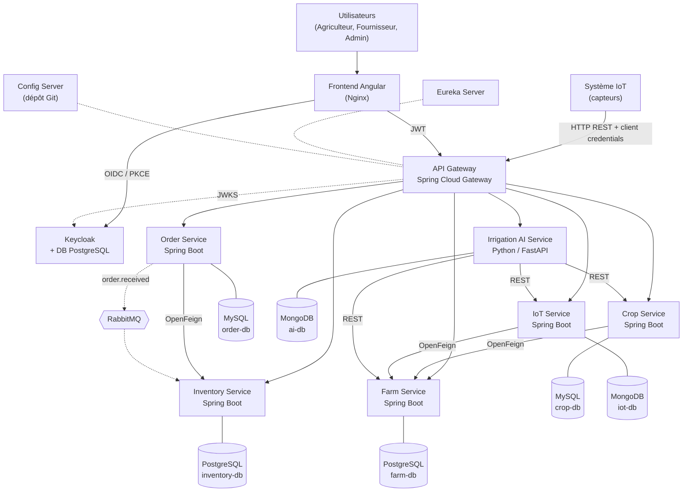

# 🌱 AgriSmart

> **Plateforme intelligente de gestion et d'optimisation des exploitations agricoles**
> Mini-projet du module **AWD** (Architecture des Applications Web Distribuées) : Validation 1, année universitaire 2026-2027


-orange)

---

## 📑 Sommaire

1. [Équipe](#-1-équipe)
2. [Présentation du projet](#-2-présentation-du-projet)
3. [Acteurs et fonctionnalités](#-3-acteurs-et-fonctionnalités)
4. [Découpage en microservices](#-4-découpage-en-microservices)
5. [Données : une base par microservice](#-5-données--une-base-par-microservice)
6. [Communication entre microservices](#-6-communication-entre-microservices)
7. [Architecture technique](#-7-architecture-technique)
8. [Conception détaillée de chaque microservice](#-8-conception-détaillée-de-chaque-microservice)
9. [Structure du dépôt](#-9-structure-du-dépôt)
10. [Lancement du projet](#-10-lancement-du-projet)
11. [Organisation de l'équipe et workflow Git](#-11-organisation-de-léquipe-et-workflow-git)
12. [État d'avancement et décisions à valider](#-12-état-davancement-et-décisions-à-valider)
13. [Documentation et livrables](#-13-documentation-et-livrables)

---

## 👥 1. Équipe

| N° | Nom et prénom | Microservice responsable | Technologie | Composant transverse |
|----|---------------|--------------------------|-------------|----------------------|
| 1 | **Nayssen Ksissa** | Farm Management Service | Spring Boot · PostgreSQL | Config Server |
| 2 | **Meriem Bouguila** | Crop Management Service | Spring Boot · MySQL | Eureka Server |
| 3 | **Mohamed Souhail Sboui** | Inventory Management Service | Spring Boot · PostgreSQL | Docker Compose |
| 4 | **Abdel Malek Louati** | Order Management Service | Spring Boot · MySQL | API Gateway |
| 5 | **Mohamed Salem** | IoT Monitoring Service | Spring Boot · MongoDB | Keycloak |
| 6 | **Ayette Boubaya** | Smart Irrigation AI Service | Python · FastAPI · Scikit-learn · MongoDB | Jeu de données, coordination du dossier |

- **Classe** : 4 SSA 8, **Groupe** : 2
- **Enseignant** : Bilel May
- **Module** : AWD, cycle ingénieur informatique, ESPRIT, 2026-2027
- **Contact des membres** : *[e-mails et profils GitHub à compléter]*

---

## 🌾 2. Présentation du projet

### Contexte et problème

Dans beaucoup d'exploitations agricoles, les informations sont dispersées entre carnets papier, tableurs et échanges informels : parcelles et sols, cultures en cours, stocks de semences, d'engrais et de pesticides, commandes aux fournisseurs, conditions environnementales (humidité du sol, température). Cette dispersion ralentit la prise de décision. L'irrigation en est l'exemple typique : l'eau est une ressource limitée, et la décision d'arroser repose souvent sur l'expérience et des observations ponctuelles.

### Problématique

> Comment concevoir une plateforme intelligente et centralisée permettant aux agriculteurs de gérer efficacement leurs exploitations, de surveiller leurs cultures et leurs ressources, et d'optimiser l'irrigation grâce à l'exploitation des données IoT et aux techniques d'intelligence artificielle ?

### Solution : AgriSmart

Une plateforme web reposant sur une **architecture microservices** : chaque capacité métier est confiée à un service autonome, propriétaire de ses données. Elle centralise :

- la gestion des exploitations, parcelles et sols ;
- le suivi des cultures, plantations et récoltes ;
- la gestion des stocks agricoles (alertes de stock faible) ;
- la gestion des commandes et des fournisseurs ;
- la surveillance IoT (humidité du sol, température) avec détection d'anomalies ;
- la **recommandation d'irrigation** par Machine Learning.

### Valeur ajoutée

| Dimension | Apport |
|-----------|--------|
| Centralisation | Un point d'accès unique à des informations dispersées |
| Suivi en continu | Mesures environnementales historisées |
| Aide à la décision | Recommandations d'irrigation fondées sur des données |
| Gestion des ressources | Visibilité sur stocks et commandes, alertes de stock faible |
| Modularité | Services indépendants, développés en parallèle et évolutifs séparément |

---

## 🎭 3. Acteurs et fonctionnalités

### Acteurs

| Acteur | Type | Rôle |
|--------|------|------|
| **Agriculteur** | Humain, principal | Gère exploitation, cultures, stocks, commandes ; consulte mesures et recommandations |
| **Fournisseur** | Humain | Traite les commandes qui lui sont adressées |
| **Administrateur** | Humain | Gère comptes et rôles, supervise la plateforme |
| **Système IoT** | Technique, externe | Capteurs qui transmettent humidité et température |

### Besoins fonctionnels (extrait)

| Code | Besoin | Acteur | Microservice |
|------|--------|--------|--------------|
| BF-01 à 03 | Exploitations, parcelles, caractéristiques du sol | Agriculteur | Farm |
| BF-04 à 06 | Catalogue de cultures, plantations, récoltes | Agriculteur | Crop |
| BF-07 à 09 | Produits, mouvements de stock, alerte de stock faible | Agriculteur | Inventory |
| BF-10 à 13 | Commandes, fournisseurs, statuts, historique | Agriculteur, Fournisseur, Admin | Order |
| BF-14 à 17 | Capteurs, mesures, historique, anomalies | Agriculteur, Système IoT | IoT |
| BF-18, 19 | Prédiction et recommandations d'irrigation | Agriculteur | Irrigation AI |
| BF-20 | Comptes, rôles, autorisations | Administrateur | Keycloak |
| BF-21, 22 | Supervision, tableau de bord | Administrateur, Agriculteur | Infrastructure / Frontend |

La liste complète (22 besoins fonctionnels, 10 besoins non fonctionnels, 5 cas d'utilisation détaillés) figure dans le dossier de conception.

### Périmètre

- **Inclus** : les six capacités métier ci-dessus, la gestion des comptes et un tableau de bord.
- **Exclu de la V1** : commande physique des équipements d'irrigation (AgriSmart *recommande* mais ne pilote rien), comptabilité agricole, paie, marketplace publique, maintenance prédictive des machines.

---

## 🧩 4. Découpage en microservices

Le découpage suit la logique des **contextes bornés** (une capacité métier par service, pas de découpage par table ni par écran). Chaque donnée a **un seul service propriétaire**.

| # | Microservice | Contexte borné | Entités | Techno | Base |
|---|--------------|----------------|---------|--------|------|
| 1 | **Farm Management** | Exploitations, parcelles, sol | Farm, Field, Soil | Spring Boot | PostgreSQL |
| 2 | **Crop Management** | Cultures, plantations, récoltes | Crop, Planting, Harvest | Spring Boot | MySQL |
| 3 | **Inventory Management** | Produits, stocks, mouvements | Product, Stock, StockMovement | Spring Boot | PostgreSQL |
| 4 | **Order Management** | Commandes, fournisseurs, statuts | Order, OrderItem, Supplier | Spring Boot | MySQL |
| 5 | **IoT Monitoring** | Capteurs, mesures, anomalies | Sensor, Measurement, SensorAlert | Spring Boot | MongoDB |
| 6 | **Smart Irrigation AI** *(technologie avancée)* | Prédictions et recommandations | IrrigationPrediction, IrrigationRecommendation | Python, FastAPI, Scikit-learn | MongoDB (provisoire) |

### Frontières métier

- **Farm / Crop** : la parcelle (lieu, surface, sol) relève de Farm ; ce qui y est planté relève de Crop.
- **Inventory / Order** : Inventory sait ce que l'on possède ; Order sait ce que l'on a demandé et à qui. Un stock n'est jamais modifié directement par Order.
- **IoT / AI** : IoT collecte et conserve les mesures brutes ; AI les interprète et ne garde que l'instantané utilisé pour chaque prédiction.
- **Comptes et rôles** : gérés par **Keycloak**, il n'y a pas de microservice « utilisateurs ».

> Le sujet impose quatre microservices métier plus un microservice à technologie avancée. L'équipe compte six membres et propose donc **cinq services métier + un service IA** pour que chacun soit responsable d'un service. En cas de refus, repli prévu : fusionner Inventory et Order en un service d'approvisionnement.

---

## 🗄️ 5. Données : une base par microservice

**Aucune base partagée.** Même lorsque deux services utilisent la même technologie, ils ne partagent ni instance, ni schéma, ni identifiants.

| Microservice | Base dédiée | Justification du choix |
|--------------|-------------|------------------------|
| Farm | PostgreSQL | Données structurées et fortement liées ; intégrité référentielle Farm, Field, Soil ; PostGIS possible plus tard |
| Crop | MySQL | Données transactionnelles à schéma stable, jointures simples |
| Inventory | PostgreSQL | Transactions ACID : jamais de quantité négative, mouvement et stock mis à jour ensemble, idempotence via contrainte d'unicité |
| Order | MySQL | Structure en-tête/lignes, totaux, workflow de statuts |
| IoT | MongoDB | Mesures horodatées, très nombreuses, écrites en continu ; collections time series ; schéma flexible |
| Smart Irrigation AI | MongoDB *(provisoire)* | Document autonome avec instantané imbriqué ; PostgreSQL/JSONB reste une alternative |

**Règles communes**

- Références entre services : **identifiants logiques uniquement** (UUID), sans clé étrangère. L'existence est vérifiée par appel d'API.
- Chaque entité appartenant à un agriculteur porte un `ownerId` égal au `sub` du jeton Keycloak.
- API préfixées par `/api/v1`, codes de statut : 200, 201, 204, 400, 401, 403, 404, 409, 503.

---

## 🔗 6. Communication entre microservices

Sept interactions seulement, volontairement limitées pour réduire le couplage. Le graphe d'appels est **sans cycle**.

| Réf. | Appelant → Appelé | Mode | Objet | Si l'appelé est indisponible |
|------|-------------------|------|-------|------------------------------|
| I-01 | Crop → Farm | Synchrone (OpenFeign) | Valider et décrire une parcelle | Création refusée (503) ; lecture avec `field = null` |
| I-02 | IoT → Farm | Synchrone (OpenFeign) | Valider la parcelle d'un capteur | Enregistrement refusé (503) ; ingestion des mesures non affectée |
| I-03 | AI → IoT | Synchrone (REST) | Synthèse des mesures | Pas de prédiction (503) |
| I-04 | AI → Crop | Synchrone (REST) | Plantation active | Prédiction **dégradée** (valeurs par défaut, confiance réduite) |
| I-05 | AI → Farm | Synchrone (REST) | Parcelle et sol | Prédiction **dégradée** |
| I-06 | Order → Inventory | Synchrone (OpenFeign) | Vérifier les produits d'une commande | Commande refusée (503) |
| I-07 | Order → Inventory | **Asynchrone (RabbitMQ)** | Événement `order.received` | Messages conservés en file durable, DLQ en cas d'échecs répétés |

### Pourquoi synchrone ou asynchrone ?

- **Synchrone** quand l'appelant a *besoin immédiatement* de la réponse (valider une référence, obtenir une donnée à calculer).
- **Asynchrone** quand l'émetteur n'a pas besoin de la réponse et que la disponibilité d'un service ne doit pas dépendre d'un autre : la mise à jour du stock après réception d'une commande ne doit pas échouer si Inventory est momentanément arrêté.
- **RabbitMQ plutôt que Kafka** : faible volume d'événements, un seul conteneur, intégration Spring AMQP simple.

### Résilience

Timeout court (2 à 3 s), disjoncteur Resilience4j, au plus une ou deux nouvelles tentatives (lectures uniquement), comportement de repli défini pour chaque interaction. Règle générale : une écriture qui dépend d'une vérification distante est **refusée** plutôt qu'acceptée sans contrôle.

---

## 🏗️ 7. Architecture technique



*Trait plein : appel synchrone. Pointillé : asynchrone ou infrastructure. Tous les microservices s'enregistrent auprès d'Eureka et chargent leur configuration depuis le Config Server (liens non dessinés un par un pour la lisibilité). Le diagramme complet est dans `Documentation/Diagrams/`.*

### Stack imposée et envisagée

| Couche | Technologie |
|--------|-------------|
| Frontend | Angular (SPA servie par Nginx) |
| API Gateway | Spring Cloud Gateway : routage `lb://`, validation JWT, CORS |
| Découverte de services | Netflix Eureka |
| Configuration centralisée | Spring Cloud Config Server (dépôt Git) |
| Authentification | Keycloak (OpenID Connect, OAuth 2.0) : rôles `FARMER`, `SUPPLIER`, `ADMIN`, `IOT` |
| Microservices métier | Java 17/21, Spring Boot, Spring Data JPA / MongoDB |
| Communication | REST, Spring Cloud OpenFeign, RabbitMQ |
| Résilience | Resilience4j |
| Service IA | Python, FastAPI, Scikit-learn |
| Bases | PostgreSQL, MySQL, MongoDB |
| Conteneurisation | Docker, Docker Compose |

### Sécurité

Le Gateway valide le JWT ; chaque microservice, configuré comme serveur de ressources OAuth 2.0, le revalide et applique les règles par rôle et par `ownerId` (défense en profondeur). Les secrets ne sont pas stockés en clair dans le dépôt : ils sont fournis par variables d'environnement.

---

## 🔍 8. Conception détaillée de chaque microservice

### 8.1 Farm Management Service (Nayssen Ksissa)

**Entités** : `Farm` (id, name, ownerId, address, region, lat/long…), `Field` (id, farmId, name, areaHa, irrigationType, status…), `Soil` (id, fieldId, soilType, phLevel, waterRetention…).
**Règles** : une exploitation ne peut être supprimée tant qu'elle contient des parcelles ; une parcelle a au plus une fiche de sol.

| Méthode | Ressource | Description | Succès |
|---------|-----------|-------------|--------|
| POST / GET / PUT / DELETE | `/api/v1/farms` | CRUD exploitation | 201 / 200 / 200 / 204 |
| POST / GET | `/api/v1/farms/{id}/fields` | Ajouter / lister les parcelles | 201 / 200 |
| GET / PUT / DELETE | `/api/v1/fields/{id}` | Parcelle (avec résumé du sol), appelée par Crop, IoT, AI | 200 / 200 / 204 |
| PUT / GET | `/api/v1/fields/{id}/soil` | Créer ou remplacer / consulter la fiche de sol | 200,201 / 200 |

### 8.2 Crop Management Service (Meriem Bouguila)

**Entités** : `Crop`, `Planting` (cropId, fieldId *(ext.)*, plantingDate, growthStage, status…), `Harvest`.

| Méthode | Ressource | Description | Succès |
|---------|-----------|-------------|--------|
| POST / GET / PUT / DELETE | `/api/v1/crops` | Catalogue de cultures | 201 / 200 / 200 / 204 |
| POST / GET | `/api/v1/plantings` | Planifier (vérifie la parcelle auprès de Farm) / lister (filtres `fieldId`, `status`) | 201 / 200 |
| GET / PUT / DELETE | `/api/v1/plantings/{id}` | Consulter (enrichie de la parcelle) / modifier / annuler | 200 / 200 / 204 |
| PATCH | `/api/v1/plantings/{id}/status` | Changer statut ou stade de croissance | 200 |
| POST / GET | `/api/v1/plantings/{id}/harvests` | Enregistrer / lister les récoltes | 201 / 200 |

### 8.3 Inventory Management Service (Mohamed Souhail Sboui)

**Entités** : `Product`, `Stock` (currentQuantity, minThreshold), `StockMovement` (type, quantity, sourceOrderId *(ext.)*).
**Règles** : la quantité n'est modifiée que par un mouvement ; alerte de stock faible calculée (`currentQuantity ≤ minThreshold`) ; unicité `(sourceOrderId, stockId)` pour l'idempotence.

| Méthode | Ressource | Description | Succès |
|---------|-----------|-------------|--------|
| POST / GET / PUT / DELETE | `/api/v1/products` | Produits (suppression = désactivation) ; `GET /{id}` appelée par Order | 201 / 200 / 200 / 204 |
| GET | `/api/v1/stocks`, `/api/v1/stocks/{productId}` | Consulter les stocks | 200 |
| PATCH | `/api/v1/stocks/{productId}/threshold` | Modifier le seuil | 200 |
| GET | `/api/v1/stocks/low` | Produits en stock faible | 200 |
| POST / GET | `/api/v1/stockmovements` | Enregistrer entrée, sortie, correction / historique | 201 / 200 |

### 8.4 Order Management Service (Abdel Malek Louati)

**Entités** : `Supplier`, `Order`, `OrderItem` (productId *(ext.)* + productName conservé).
**Cycle de vie** : `PENDING → CONFIRMED | REFUSED` → `SHIPPED` → `RECEIVED` ; `PENDING → CANCELLED`. Toute autre transition est rejetée (409).

| Méthode | Ressource | Description | Succès |
|---------|-----------|-------------|--------|
| POST / GET / PUT | `/api/v1/suppliers` | Gérer les fournisseurs | 201 / 200 / 200 |
| POST | `/api/v1/orders` | Créer une commande (vérifie les produits auprès d'Inventory) | 201 (503 si Inventory KO) |
| GET | `/api/v1/orders` | Commandes de l'agriculteur ou reçues par le fournisseur | 200 |
| GET | `/api/v1/orders/{id}` | Détail avec lignes | 200 |
| PATCH | `/api/v1/orders/{id}/status` | Changer le statut (rôle selon la transition) ; `RECEIVED` publie `order.received` | 200 |

### 8.5 IoT Monitoring Service (Mohamed Salem)

**Collections MongoDB** : `Sensor`, `Measurement` (fieldId copié pour requêtes rapides), `SensorAlert`.
**Anomalies** : règles simples (valeur hors plage, seuils configurables, capteur silencieux), sans Machine Learning.
**Ingestion** : HTTP REST avec identifiants de service Keycloak (rôle `IOT`).

| Méthode | Ressource | Description | Succès |
|---------|-----------|-------------|--------|
| POST / GET / PUT / DELETE | `/api/v1/sensors` | Capteurs (création vérifie la parcelle auprès de Farm) | 201 / 200 / 200 / 204 |
| POST | `/api/v1/measurements` | Transmettre une mesure (rôle `IOT`) | 201 |
| GET | `/api/v1/sensors/{id}/measurements` | Historique (filtres de dates) | 200 |
| GET | `/api/v1/measurements/summary` | Synthèse moyenne/min/max/dernière valeur par `fieldId` et période, appelée par AI | 200 |
| GET / PATCH | `/api/v1/alerts` | Lister / acquitter ou clore une alerte | 200 |

### 8.6 Smart Irrigation AI Service (Ayette Boubaya)

**Documents** : `IrrigationPrediction` (avec `inputSnapshot` imbriqué pour rester explicable et reproductible), `IrrigationRecommendation`.
**Fonctionnement** : agrège la synthèse des mesures (IoT), la plantation active (Crop) et la parcelle/sol (Farm), applique le modèle, enregistre prédiction et recommandation. Mode **dégradé** si Crop ou Farm sont indisponibles.
**Modèle** : à concevoir (régression pour la quantité d'eau, classification pour la décision d'irriguer) ; une version de référence à base de règles agronomiques est prévue en attendant.

| Méthode | Ressource | Description | Succès |
|---------|-----------|-------------|--------|
| POST | `/api/v1/irrigation/predictions` | Demander une prédiction (corps : `fieldId`) | 201 |
| GET | `/api/v1/irrigation/predictions` | Historique (filtres `fieldId`, dates) | 200 |
| GET | `/api/v1/irrigation/predictions/{id}` | Prédiction et instantané | 200 |
| GET | `/api/v1/irrigation/recommendations` | Lister les recommandations | 200 |
| PATCH | `/api/v1/irrigation/recommendations/{id}` | Acquitter | 200 |
| GET | `/api/v1/irrigation/model` | Version et état du modèle | 200 |

---

## 📁 9. Structure du dépôt

```text
agrismart/
├── README.md
├── docker-compose.yml          # à ajouter lors du développement
├── Backend/
│   ├── farm-service/           # Spring Boot · PostgreSQL
│   ├── crop-service/           # Spring Boot · MySQL
│   ├── inventory-service/      # Spring Boot · PostgreSQL
│   ├── order-service/          # Spring Boot · MySQL
│   ├── iot-service/            # Spring Boot · MongoDB
│   ├── irrigation-ai-service/  # Python · FastAPI · Scikit-learn
│   ├── api-gateway/            # Spring Cloud Gateway
│   ├── eureka-server/          # Netflix Eureka
│   ├── config-server/          # Spring Cloud Config
│   ├── config-repo/            # fichiers de configuration
│   └── keycloak/               # export du royaume
├── Frontend/
│   └── agrismart-web/          # Angular
└── Documentation/
    ├── Presentation/           # support de la présentation orale
    ├── Diagrams/               # sources .puml et exports (cas d'utilisation, architecture, séquence)
    └── Dossier/                # sources LaTeX et PDF du dossier de conception
```

---

## 🚀 10. Lancement du projet

### Prérequis

| Outil | Version |
|-------|---------|
| JDK | 17 ou 21 *(à fixer)* |
| Maven ou Gradle | *(selon le choix de l'équipe)* |
| Python | 3.10 ou supérieur |
| Node.js / npm | LTS, avec Angular CLI |
| Docker et Docker Compose | récents |

### État à la Validation 1

Chaque dossier de `Backend/` contient un **projet initialisé avec la technologie prévue, qui compile et démarre**, sans logique métier. Le lancement orchestré complet via Docker Compose sera ajouté lors du développement.

### Démarrer un microservice Spring Boot (exemple : Farm)

```bash
cd Backend/farm-service
./mvnw spring-boot:run        # ou : ./gradlew bootRun
```

### Démarrer le service IA

```bash
cd Backend/irrigation-ai-service
python -m venv .venv
source .venv/bin/activate     # Windows : .venv\Scripts\activate
pip install -r requirements.txt
uvicorn app.main:app --reload
```

### Démarrer le frontend

```bash
cd Frontend/agrismart-web
npm install
ng serve
```

### Cible : lancement complet par conteneurs *(développement ultérieur)*

```bash
docker compose up --build
```

Ordre de démarrage prévu : **Config Server → Eureka → bases, RabbitMQ, Keycloak → microservices → API Gateway → frontend**.

| Conteneur | Rôle |
|-----------|------|
| `frontend` | Angular / Nginx |
| `api-gateway` | Point d'entrée, routage |
| `eureka-server` | Registre de services |
| `config-server` | Configuration centralisée |
| `keycloak`, `keycloak-db` | Identités et rôles |
| `farm-service`, `farm-db` | Exploitations, parcelles |
| `crop-service`, `crop-db` | Cultures, plantations |
| `inventory-service`, `inventory-db` | Stocks |
| `order-service`, `order-db` | Commandes |
| `iot-service`, `iot-db` | Capteurs, mesures |
| `irrigation-ai-service`, `ai-db` | Prédictions |
| `rabbitmq` | Messagerie asynchrone |

> Les noms et ports sont provisoires. Les mots de passe des bases et les secrets Keycloak seront passés par variables d'environnement (fichier `.env` non versionné).

---

## 🤝 11. Organisation de l'équipe et workflow Git

### Responsabilités

Chaque membre conçoit, initialise, développe et présente **son** microservice. Les composants transverses sont répartis (voir tableau de la section 1). Le frontend est développé collectivement : un module Angular par microservice, avec une coque commune (navigation, authentification).

### Branches

| Branche | Usage |
|---------|-------|
| `main` | Stable, protégée, versions validées |
| `develop` | Intégration |
| `feature/<service>-<sujet>` | Développement d'une fonctionnalité |
| `docs/<sujet>`, `fix/<sujet>` | Documentation, corrections |

Les fusions vers `develop` se font par **pull request relue par au moins un autre membre**.

### Convention de commits (Conventional Commits, portée = microservice)

```text
chore(farm): initialiser le projet Spring Boot
feat(order): ajouter la création d'une commande
docs(dossier): mettre à jour le chapitre 5
```

### Outils

| Besoin | Outil |
|--------|-------|
| Versionnement | Git, GitHub |
| Suivi des tâches | *[GitHub Projects / Jira / Trello : lien à compléter]* |
| Revue de code | Pull requests GitHub |
| API | Postman, OpenAPI |
| Diagrammes | PlantUML |
| Dossier | LaTeX (Overleaf) |

---

## 📌 12. État d'avancement et décisions à valider

### Avancement

- [x] Sujet, acteurs, besoins fonctionnels et non fonctionnels
- [x] Découpage en six microservices et frontières métier
- [x] Modèle de données et API REST prévue pour chaque service
- [x] Interactions inter-services, modes de communication et cas de panne
- [x] Diagrammes : cas d'utilisation, classes, séquence, architecture, dépendances
- [x] Dossier de conception
- [x] Projets des microservices créés dans `Backend/`
- [ ] Logique métier *(hors périmètre de la Validation 1)*
- [ ] Sécurité Keycloak, intégration inter-services, frontend, Docker Compose

### Décisions provisoires à valider avec l'enseignant

| # | Point | Proposition de l'équipe |
|---|-------|-------------------------|
| 1 | Nombre de microservices | Six (cinq métier + un IA) au lieu de cinq ; repli : fusion Inventory + Order |
| 2 | OpenFeign pour le service Python | Client HTTP (`httpx`) et client Eureka Python, équivalent fonctionnel |
| 3 | Sémantique de la mise à jour du stock | Stock mis à jour à la **réception** (`RECEIVED`) et non à la confirmation du fournisseur |
| 4 | Base du service IA | MongoDB provisoire, PostgreSQL envisageable |
| 5 | Emplacement des projets d'infrastructure | Dans `Backend/` ; sinon déplacés dans `Infrastructure/` |
| 6 | Fiabilité de l'événement `order.received` | Transactional outbox, selon le temps disponible |

> ⚠️ **Machine Learning** : aucun modèle n'est entraîné et aucun jeu de données n'est encore constitué. Il s'agit d'une conception prévue.

---

## 📚 13. Documentation et livrables

| Livrable | Emplacement |
|----------|-------------|
| Dossier de conception (PDF et sources LaTeX) | `Documentation/Dossier/` |
| Diagrammes (cas d'utilisation, architecture, séquences) | `Documentation/Diagrams/` |
| Support de présentation | `Documentation/Presentation/` |
| Dépôt Blackboard | Lien du dépôt, nom du projet et membres déposés |

---

<p align="center">
  <b>AgriSmart</b> · Module AWD · ESPRIT · 4 SSA 8, Groupe 2 · 2026-2027<br/>
  Enseignant : Bilel May
</p>
